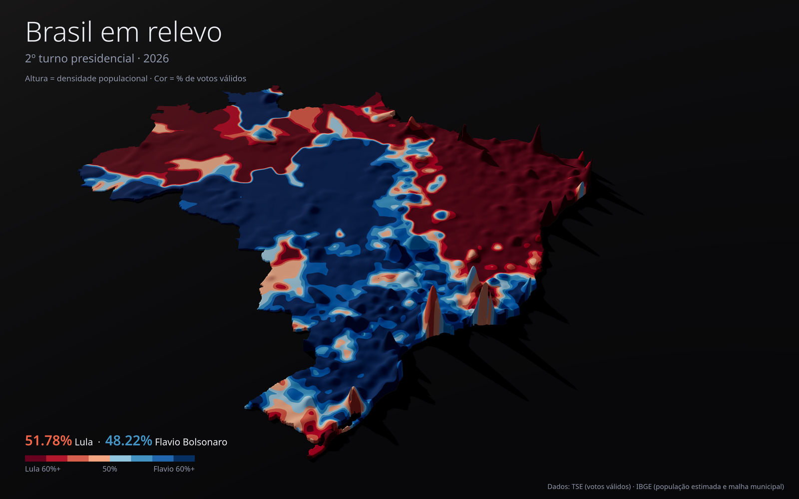

# Brasil 3D: 2º turno presidencial

Mapa 3D dos municípios brasileiros: **altura = população** (ou densidade, ou votos válidos) e **cor = % de votos válidos** no 2º turno (vermelho = Lula, azul = adversário).

**Mapa interativo:** https://ythanos.github.io/election_map/ · **Pôster em relevo:** https://ythanos.github.io/election_map/poster.html



## Como rodar

```bash
uv run scripts/build_data.py            # baixa os dados e gera web/data/municipios.geojson
uv run scripts/build_poster.py          # gera as grades do pôster em web/poster/ (depende do anterior)
python3 -m http.server 8000 -d web      # abra http://localhost:8000
```

Opções do script: `--ano 2022` (outra eleição; o adversário é detectado sozinho) e `--ano-pop 2025` (ano da estimativa de população). Os downloads ficam em cache em `data/raw/`. Apague um arquivo de lá para baixá-lo de novo, por exemplo quando o TSE atualizar o zip.

## Fontes

| Dado | Fonte |
|---|---|
| Votos válidos por município, 2º turno, Presidente | TSE, dados abertos: `votacao_candidato_munzona_<ano>.zip`, arquivo `*_BR.csv` (exterior excluído) |
| População residente estimada | IBGE/SIDRA, tabela 6579 |
| Malha municipal (qualidade mínima) | IBGE, API de malhas v3 |
| De-para código TSE → IBGE | [betafcc/Municipios-Brasileiros-TSE](https://github.com/betafcc/Municipios-Brasileiros-TSE), com fallback por UF + nome |

## Estrutura

- `scripts/build_data.py`: pipeline em Python, só biblioteca padrão
- `web/index.html`, `web/main.js`, `web/style.css`: visualização com deck.gl 9.1.14 (MIT), carregado via unpkg
- `scripts/build_poster.py`: gera a superfície suave do pôster (numpy, scipy e Pillow: BSD/MIT-CMU)
- `web/poster.html`, `web/poster.js`, `web/poster.css`: pôster em relevo com three.js 0.170.0 (MIT), com exportação em PNG de 3× a resolução da tela

### Como o relevo do pôster é calculado

A população de cada município é espalhada uniformemente pelo seu território numa grade de cerca de 2,2 km/px e suavizada com filtro gaussiano (σ = 20 km). A suavização é uma convolução normalizada pela área de terra, para as cidades litorâneas não perderem altura para o mar. A cor é a razão entre os votos do Lula e os votos válidos, ambos suavizados do mesmo jeito. Os parâmetros `--sigma-km` e `--sigma-cor-km` controlam o quanto o relevo e a cor ficam suaves.

## Faixas de cor (% de votos válidos do Lula no município)

60+ · 56–60 · 53–56 · 50–53 (tons de vermelho) | 47–50 · 44–47 · 40–44 · <40 (tons de azul), paleta ColorBrewer RdBu.
Os limites ficam em `FAIXAS`, em `web/main.js`.
